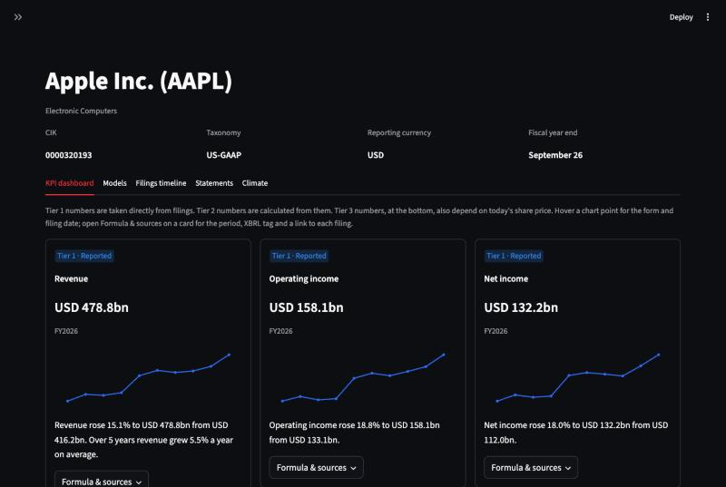
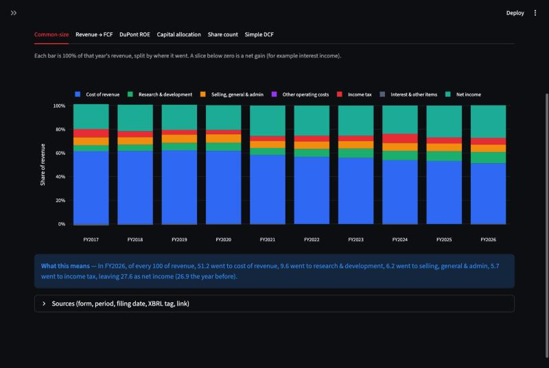
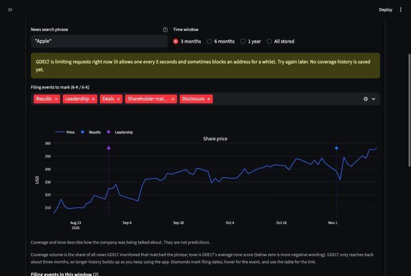

# Filing Lens

A personal, free, local-first tool that turns public-company SEC filings into clear visuals, builds simple financial models from those filings, and shows the news "climate" around a company over time.

**Educational tool, not investment advice.**



## What it does

- **Company search.** Start typing a company name or ticker ("apple") and pick from the dropdown, or enter an SEC CIK number, to see the company, its accounting taxonomy (US-GAAP or IFRS), reporting currency and fiscal year end.
- **Verdict.** The first tab: one word each for the long term and the short term (Favourable, Mixed or Unfavourable), with the signals behind it. It summarises evidence by fixed rules in `src/metrics/verdict.py`; it is not advice, not a forecast, and knows nothing about your circumstances.
- **KPI dashboard.** Twelve cards with value, sparkline, a one-sentence rule-based explanation, and the formula and sources behind every number. Four more cards show price-based multiples.
- **Scorecard.** Rule-based letter grades (A to E, with a 0–100 score) for the business's current state, historical record and future readiness, one grade per model, and a separate grade for the news climate. Every grade shows the inputs, thresholds and weights behind it.
- **Health checks.** A red-flag checklist (profit ahead of cash, receivables or inventory outpacing sales, heavy stock pay, goodwill, debt, interest cover, liquidity, dividend cover, dilution, sliding margins, auditor events), the Piotroski F-score and the Altman Z-score.
- **Compare.** Up to four peers you choose, side by side on the main ratios and the three business grades.
- **Models.** Common-size income statement, revenue-to-free-cash-flow bridge, DuPont ROE, capital allocation, share count, and a simple DCF that outputs a sensitivity range, never a single price. The DCF also runs in reverse: the growth today's price already assumes, next to the growth actually delivered.
- **Watchlist.** Save tickers in the sidebar and reopen them with one click (stored locally).
- **Filings timeline.** Every filing, filterable by form type, linked to the original document on sec.gov.
- **Statements.** Income statement, balance sheet and cash flow for a fiscal year next to the prior year.
- **Climate.** Share price with markers for 8-K / 6-K filings, news coverage volume and tone, and a headline list. Clearly labelled as context, not financial data.





## Ground rules

1. **Free to run.** No paid APIs and no API keys.
2. **No AI at runtime.** The app never calls a language model; explanations are fixed templates filled with computed numbers. A test enforces this.
3. **Numbers come only from SEC filings** (EDGAR XBRL data). If a company does not report something, the app says "Not reported" instead of estimating.
4. **Every number shows where it came from:** form, fiscal period, filing date, XBRL tag and a link to the filing.
5. **News is context, not data.** It sits in its own panel and never feeds a KPI.

The Scorecard is a deliberate addition to the original spec, which excluded ratings. Its grades are fixed arithmetic on filed numbers (thresholds in `src/metrics/ratings.py`), the same for every company and not adjusted for industry. The three business grades use filings only; the news-climate grade is kept apart and never feeds them. "Future readiness" reflects recent trends and financial capacity, not a forecast, and no grade is a recommendation to buy or sell.

KPIs are labelled by tier: Tier 1 is reported as filed, Tier 2 is calculated from filed numbers, Tier 3 also depends on today's share price.

## Setup

Python 3.9 or newer.

```bash
python3 -m venv .venv
.venv/bin/pip install -r requirements.txt
cp .env.example .env
```

Edit `.env` and set `SEC_USER_AGENT` to your name and email. The SEC requires a contact address from automated clients; without it, ticker search is refused (a numeric CIK still works). `.env` is git-ignored and is the only configuration the app needs.

## Run

```bash
.venv/bin/streamlit run app.py
```

## Tests

```bash
.venv/bin/pip install -r requirements-dev.txt
.venv/bin/python -m pytest
```

- **Golden tests** (`tests/golden/*.json`) compare parsed revenue, net income, operating cash flow and capex for Apple (US-GAAP, 10-K, USD) and Unilever (IFRS, 20-F, EUR) with the figures in their filings. They need network access on first run and use the local cache afterwards.
- **Unit tests** cover every formula in `src/metrics/` and every sentence template in `src/explain/`.
- **Guard tests** fail if an AI library is imported or listed in `requirements.txt`, or if `.env` is tracked by git.

## Deploy to Streamlit Community Cloud (free)

1. Push this folder to a GitHub repository. Check first that `.env` and `data/` are not included (`git status` should not list them).
2. At [share.streamlit.io](https://share.streamlit.io), choose **Create app**, pick the repository and branch, and set the main file to `app.py`.
3. Under **Advanced settings**, choose Python 3.11 or newer and add this secret (root-level secrets are passed to the app as environment variables):

   ```toml
   SEC_USER_AGENT = "Your Name your@email.com"
   ```

4. Deploy.

Things that behave differently in the cloud:

- The cache (`data/cache.db`) lives on temporary storage and is wiped when the app restarts, so the accumulated GDELT history does not persist there.
- The SEC, Yahoo Finance and GDELT can rate-limit or refuse requests from shared cloud addresses. The app shows a message and keeps the filing views working where it can; if the SEC itself refuses, nothing loads.
- A public app sends your SEC contact address to the SEC on every visitor's request. Keep the app private, or use an address you are comfortable with.

## Data sources and their terms

| Source | Used for | Notes |
|---|---|---|
| SEC EDGAR (`data.sec.gov`, `www.sec.gov`) | All financial numbers, filing lists, event markers | Public domain. Limit is 10 requests per second; the app throttles to 5 and caches for 24 hours. |
| Yahoo Finance via `yfinance` | Daily share prices | Unofficial client; personal use only. Cached for 12 hours. |
| Stooq CSV | Fallback for prices | Currently answers with a browser check instead of data, so the fallback rarely works. |
| Frankfurter API | Currency conversion (ECB reference rates) | Free, no key. Cached for 12 hours. |
| GDELT DOC 2.0 API | News coverage volume and tone | Free, no key, one request every 5 seconds. Fetched only when you press the button; every pull is stored permanently so history builds up. |
| Google News RSS | Headline titles, outlets and links | Personal, non-commercial use per the feed's terms. Article text is never fetched. |

## Known limits

- **Restated years.** The latest filed value is used and flagged with †. Companies restate only the two or three years shown in a filing, so a long series can mix restated and original figures (for example a share count before and after a split). Affected cards say so; the numbers are not adjusted.
- **Missing tags.** Companies choose their own XBRL tags. Metrics are matched against a list of known tags in `src/edgar/concept_map.py`; anything not matched shows as "Not reported". The list was checked against 16 large companies (see the note at the top of that file) and will still need extending for others.
- **Banks and insurers** report a different income statement, so many metrics, grades and checks show as not available for them.
- **Same thresholds for every industry.** Grades and red flags use fixed thresholds, so compare a company with peers in the same business (the Compare tab) rather than reading a grade in isolation.
- **Foreign filers.** Price multiples need the number of ordinary shares per US-listed share (ADR ratio). It is set per ticker in `src/config.py`, editable in the app, and should be confirmed against the company's 20-F. Interim data is half-yearly or absent for many foreign filers.
- **Multiples use the latest fiscal year,** not the trailing twelve months.
- **GDELT** reaches back only a short window and often refuses requests; the panel then shows whatever history is already stored.
- **Golden test values** were recalled from the printed statements and agree with the XBRL data; they were not re-read from the filing documents.

## Project layout

```
app.py                  Streamlit entry point and all views
src/config.py           settings, URLs, rate limits
src/edgar/              SEC client, ticker lookup, filings, facts, tag map
src/normalize/          fiscal periods, restatements, statements, FX
src/metrics/            KPI formulas, models, market multiples, ratings, health checks (pure functions)
src/explain/rules.py    rule-based sentence templates (no AI)
src/market/prices.py    prices with fallback and cache
src/climate/            GDELT, filing events, headlines
src/viz/charts.py       Plotly figures
src/cache/store.py      SQLite cache
tests/                  unit, golden and guard tests
```

The full specification is in `../SPEC(FINANCE).md`.
